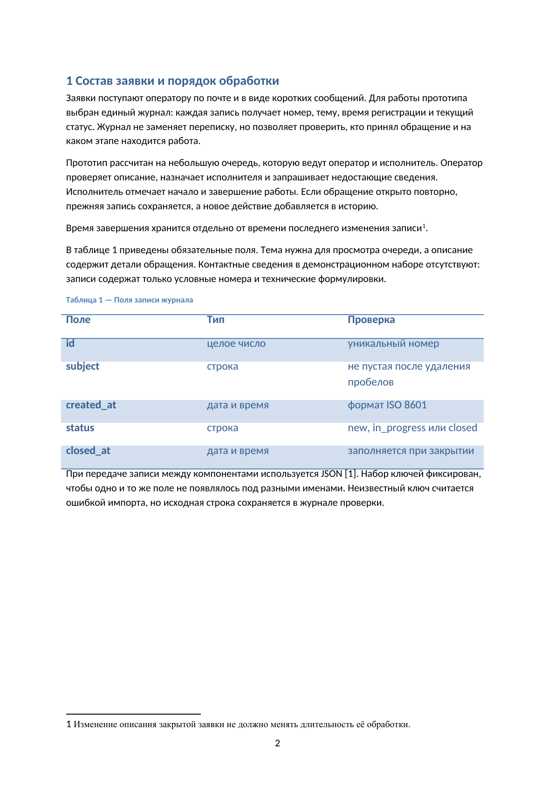
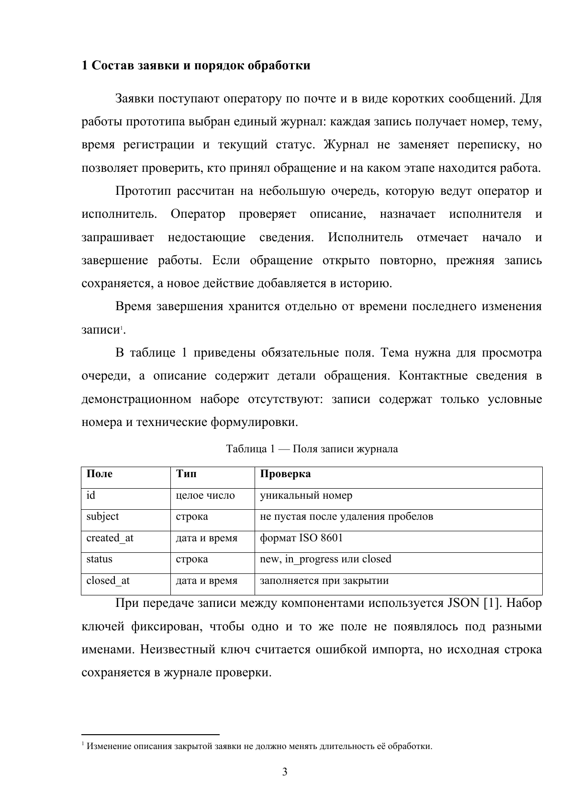
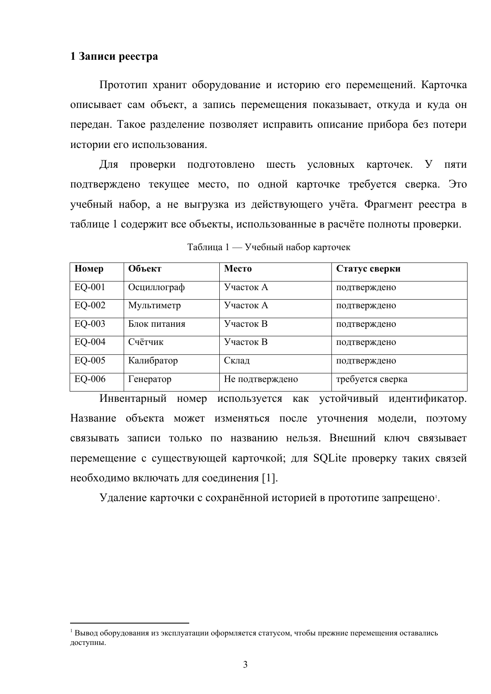
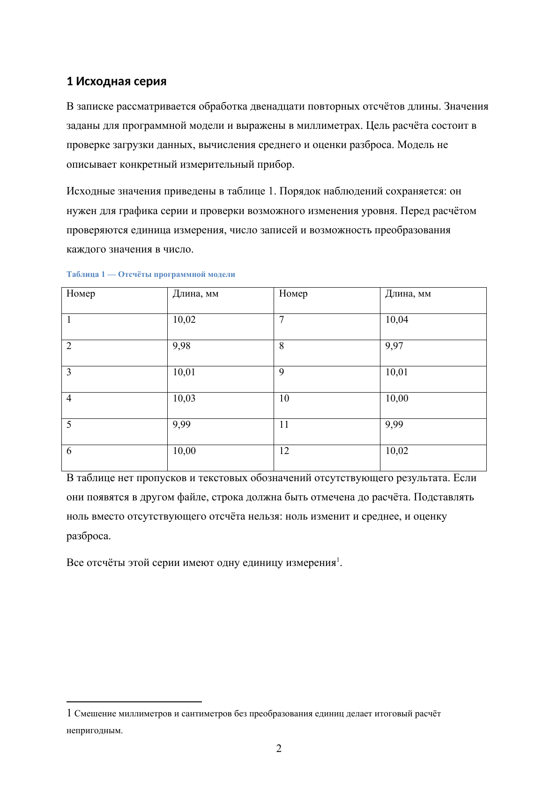

# doc-format

Навык Codex для создания, редактирования и проверки DOCX, PDF и Markdown
на русском языке.

## До и после

Три пары учебных примеров показывают изменение оформления: шрифтов, полей,
интервалов, красной строки, таблиц и подписей. Текст, числа, код и формулы
внутри каждой пары сохранены.

| До применения навыка | После применения навыка |
|---|---|
| <br>[Скачать DOCX](examples/01/before.docx) | <br>[Скачать DOCX](examples/01/after.docx) |
| <br>[Скачать DOCX](examples/02/before.docx) | <br>[Скачать DOCX](examples/02/after.docx) |
| <br>[Скачать DOCX](examples/03/before.docx) | <br>[Скачать DOCX](examples/03/after.docx) |

На превью показаны фрагменты страниц. Полные файлы содержат оглавление,
список источников, сноски, формулы, листинги и рисунки. В оформленных версиях
первый лист оставлен пустым под титул, номера начинаются со второго листа
с цифры 2 и стоят по центру снизу. Проверены все 33 страницы шести файлов.

## Использование

Скопируйте папку `doc-format` в `~/.agents/skills/` либо
в `<проект>/.agents/skills/`. Если навык не появился в списке, перезапустите Codex.

```text
$doc-format Оформи документ.docx по академическому профилю.
Содержание не меняй. Проверь все страницы.
```

[Правила оформления](SKILL.md) · [Инструменты и зависимости](rules/formats.md)
