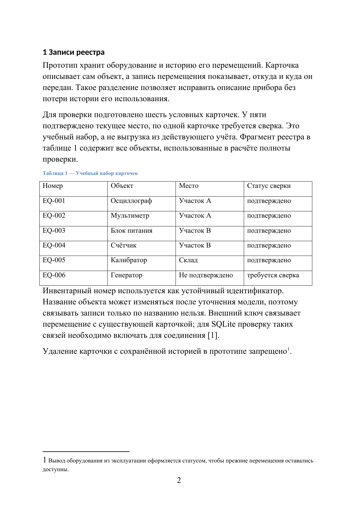
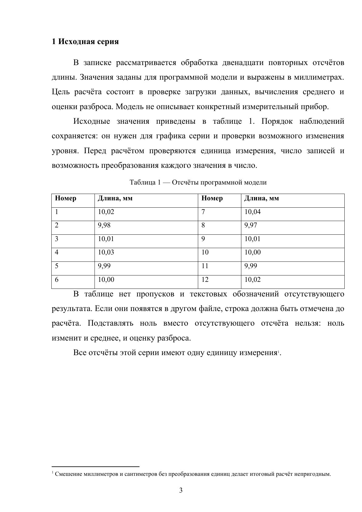

# document-craft

Навык Codex для создания, редактирования и проверки DOCX, PDF и Markdown
на русском языке. Работает с локальными файлами, без отдельного сервиса.

Новый документ получает монохромное оформление. При точечной правке сохраняются
стили исходника. Запрос «оформить» меняет вёрстку, а не содержание; редактура
текста выполняется по отдельному заданию.

## До и после

Три примера созданы для этого репозитория. Это небольшие технические записки
с учебными данными, а не чужие студенческие работы. В исходниках обычные
недочёты рабочего черновика: офисные поля, отсутствие красной строки,
несогласованные интервалы, подписи и размеры текста в таблицах.

В каждом документе есть содержание с номерами страниц, список источников,
таблицы, редактируемые формулы, листинг и рисунок. Версии `after.docx` получены
из соответствующих `before.docx` с помощью скриптов навыка и настройки
академических элементов. Текст, значения, код, формулы и сноски сохраняются.
Содержание пересчитывается после изменения пагинации.

### Журнал заявок сервисного отдела

Двенадцать учебных заявок, расчёт средней длительности и доли закрытых обращений,
выгрузка CSV на Python. В черновике оставлены стандартные офисные стили.
После оформления согласованы основной текст, таблицы и подписи; формулы
остались редактируемыми.

[До: 5 страниц](examples/01-service-requests/before.docx) ·
[После: 6 страниц](examples/01-service-requests/after.docx)

| До | После |
|---|---|
|  |  |

### Реестр оборудования и журнал перемещений

Шесть карточек оборудования, схема связей и ограничения SQLite.
В исходнике нет красной строки, подписи и таблицы используют разные интервалы.
В оформленной версии добавлен отступ первой строки, выровнены таблицы и подписи,
листинг набран шрифтом Courier New 12 пт.

[До: 5 страниц](examples/02-equipment-register/before.docx) ·
[После: 6 страниц](examples/02-equipment-register/after.docx)

| До | После |
|---|---|
|  |  |

### Обработка серии повторных измерений

Двенадцать модельных отсчётов, среднее, стандартное отклонение и график.
В черновике смешаны размеры текста, у абзацев остаются лишние интервалы.
После оформления основной текст набран в 14 пт, таблицы и подписи в 12 пт;
формулы отделены интервалами, их номера выровнены у правого поля.

[До: 5 страниц](examples/03-measurement-series/before.docx) ·
[После: 6 страниц](examples/03-measurement-series/after.docx)

| До | После |
|---|---|
|  |  |

На превью показано начало основного текста. В файлах «после» перед содержанием
есть пустой первый лист под титул. Поэтому число страниц меняется не только
из-за шрифта и интервалов. Проверены все 33 страницы шести файлов, совпадение
содержимого пар, номера в оглавлениях и положение номеров страниц.

Исходные данные и построение примеров доступны в
[examples/source-data.json](examples/source-data.json) и
[examples/build_examples.py](examples/build_examples.py).
Результаты проверок записаны в [examples/validation.json](examples/validation.json).

## Профиль оформления

- A4; поля слева 30 мм, справа 10 мм, сверху и снизу по 20 мм.
- Times New Roman 14 пт, интервал 1,5, красная строка 1,25 см.
- Таблицы и подписи 12 пт; сноски 10 пт. Заливок и цветных шапок нет.
- Первый лист резервируется под титул и остаётся пустым без номера.
  Начиная со второго листа идут номера 2, 3 и далее, по центру снизу.
- В колонтитулах только номер страницы. Жирность используется для заголовков
  и шапок таблиц, а не для каждого тезиса внутри абзаца.

Это резервный профиль навыка, а не гарантия соответствия любому ГОСТ.
Для курсовых и выпускных работ есть [академический профиль](profiles/academic.md).
Конкретные требования организации учитываются в пределах задачи.

## Текст и проверка

[Редакторский цикл](rules/anti-slop.md) включает сверку с исходными данными,
очистку рабочей текстовой копии, русский линтер и отдельное чтение результата.
Он помогает найти повторы и пустые формулировки, сохраняя смысл и оговорки.
Скрипты не определяют авторство текста и не доказывают истинность утверждений.

Для DOCX/PDF нужен просмотр страниц после рендера: свойства OOXML не покажут
обрезанную строку или подстановку шрифта. Если просмотр недоступен, навык
сообщает, какая часть проверки осталась невыполненной.

## Установка

Скопируйте папку с `SKILL.md`, `rules`, `profiles`, `scripts` и `agents`
в `<проект>/.agents/skills/document-craft/` для одного проекта либо
в `~/.agents/skills/document-craft/` для всех проектов пользователя.
[Расположение навыков описано в документации Codex](https://learn.chatgpt.com/docs/build-skills).

Вызывайте навык через `$document-craft`. Если он не появился в списке,
перезапустите Codex. Примеры из `examples` не нужны для работы скриптов,
но их можно оставить рядом с навыком.

```text
$document-craft Оформи отчёт.docx по академическому профилю.
Содержание, числа, формулы и код не меняй. Проверь все страницы.
```

```text
$document-craft Отредактируй раздел «Результаты» в записке.docx.
Сохрани факты, ограничения и оформление остальных разделов.
```

## Инструменты

Проверки текста и OOXML требуют Python 3.9+ со стандартной библиотекой.
Для создания DOCX обычно используется `python-docx`. Для рендера DOCX нужен
LibreOffice. Для преобразования PDF в изображения нужен Poppler или PyMuPDF.
Нужны установленные
шрифты с кириллицей; фактический шрифт PDF проверяется после экспорта.

Команды и ограничения описаны в [rules/formats.md](rules/formats.md).
Общий `docx_layout.py` рассчитан на DOCX с одной конечной секцией.
Он не создаёт весь академический профиль автоматически: оглавление, листинги
и сложную структуру требуется оформить отдельно и проверить по их роли.

Для воспроизведения примеров дополнительно нужны `python-docx`, `matplotlib`,
`pdfplumber` и Pillow. Сборщик запускается из корня репозитория:

```bash
python examples/build_examples.py --work-dir /путь/к/новой/рабочей/папке
```

Если LibreOffice не видит уже установленную гарнитуру, добавьте
`--font-dir /путь/к/каталогу/шрифтов`. Скрипт не скачивает шрифты и не меняет
системные настройки. Промежуточные PDF и страницы остаются в рабочей папке.
